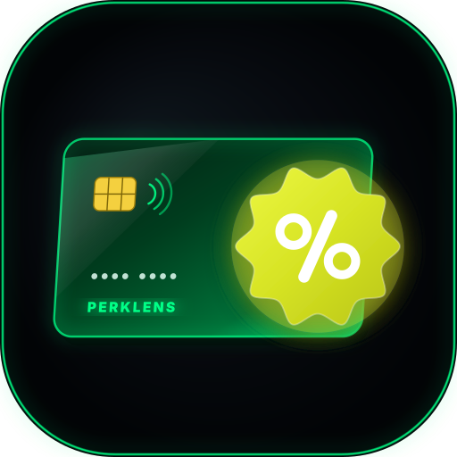
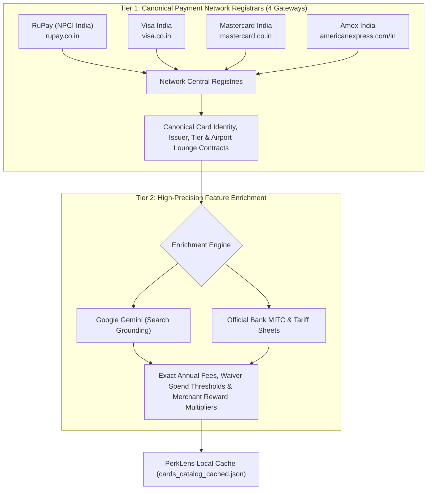
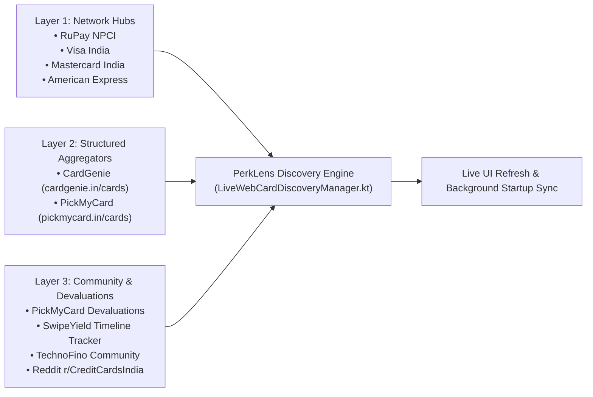
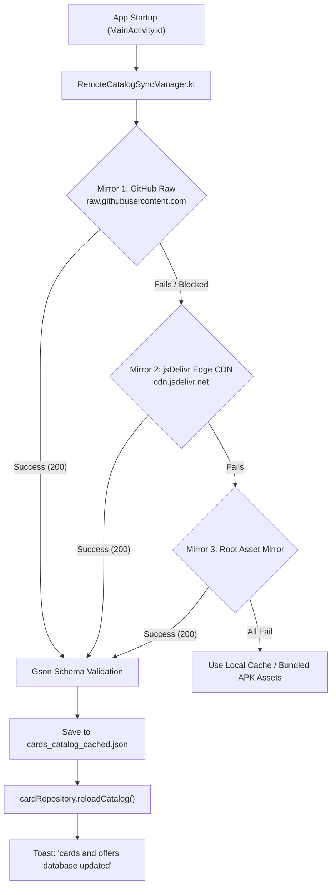

# 💳 PerkLens — Your AI Lens on Every Card, Lounge & Swipe

<p align="center">
  
</p>

<p align="center">
  <a href="https://github.com/sakinator/PerkLens/releases/latest"></a>
  <a href="#-vibe-coded-philosophy--manifesto"></a>
</p>

<p align="center">
  <a href="https://github.com/sakinator/PerkLens/actions/workflows/build-apk.yml"></a>
  
  
  
  
  
</p>

> [!NOTE]
> **✨ 100% Vibe Coded with AI:** PerkLens is vibe-coded through continuous human-AI agentic collaboration, real-time feedback loops, automated regression test suites, and live self-healing pipelines. High velocity, zero bloat, pure vibes.

A modern, privacy-first Native Android application built with **Kotlin**, **Jetpack Compose**, and **Material 3**. 
Where **ThreatLens** protects your Android device from mobile threats, **PerkLens** protects your wallet from lost airport lounge visits, expired cinema BOGOs, missed cashbacks, and hidden bank fee traps.

---

## 🏗️ System Architecture & Intelligence Pipeline

Unlike stock tickers or weather services, Indian banks (HDFC, SBI, ICICI, Axis, BoB, etc.) **do not provide an open public JSON API** for card perks. Instead, banks scatter updates across marketing landing pages, 40-page PDF circulars (MITC), SMS notifications, and merchant portals.

PerkLens solves this with an innovative **Two-Tier Network-to-Bank Resolution Pipeline** backed by a **3-Layer Real-Time Intelligence Stack**:

### 1. The Two-Tier Resolution Pipeline (Near-Zero Failure Points)



* **Why this is resilient:** Scraping 45+ individual bank websites is fragile (banks change their HTML/CSS constantly, deploy Cloudflare bot protections, or experience downtime). In contrast, all Indian cards run on 4 regulated payment networks. By using the **Payment Network as Tier 1**, failure points drop from 45+ to just 4, guaranteeing that **no card or bank is ever missed**.
* **Lounge ground truth:** In India, airport lounge access is contracted at the network tier level through DreamFolks (Visa Signature/Infinite, Mastercard World, RuPay Select). The network registry is the legal source of truth.

---

### 2. The 3-Layer Real-Time Intelligence Stack



1. **Layer 1 (Identity & Entitlement):** Official payment network portals provide canonical card names and baseline lounge access rules.
2. **Layer 2 (Cross-Validation Catalogs):** Curated databases ([CardGenie](https://cardgenie.in/cards) and [PickMyCard](https://www.pickmycard.in/cards)) provide structured fee and reward cap cross-checks to eliminate hallucinations.
3. **Layer 3 (Live Community & Devaluation Feeds):**
   - **[PickMyCard Devaluations](https://www.pickmycard.in/devaluations)** & **[SwipeYield Timeline Tracker](https://www.swipeyield.in/timeline-tracker):** Catch pre-announced devaluations, lounge spend threshold hikes (e.g. ₹35k/qtr), and fee revisions weeks before bank landing pages update.
   - **[TechnoFino Community](https://technofino.in/community/)** & **[Reddit r/CreditCardsIndia](https://www.reddit.com/r/CreditCardsIndia/):** Crowdsourced ground truth for unwritten "shadow rules", MCC code exclusions (tax, rent, utilities), and live lounge terminal acceptance.

---

### 3. Resilient Multi-Mirror Dynamic OTA Sync



* **Zero APK Reinstalls:** When bank perks change or new cards launch, updating the database in the repository automatically broadcasts changes over global CDN mirrors.
* **100% Offline Capability:** Operates with zero network lag on flights or offline using cached payloads or bundled APK assets.
* **Corrupt-Payload Defense:** If an update fails halfway or returns invalid JSON, PerkLens rejects it and preserves the good local database.

---

## 🎨 Brand Identity & Visual Design

The **PerkLens** brand features a sleek **Dark & Cyber Neon Green** modern design:
1. **The Emerald Perspective Smart Card**: Deep obsidian-to-neon green body with glowing electric cyber borders (`#00FF87`), specular sheen, metallic EMV brass chip, and contactless radio waves.
2. **The 10-Lobe Scalloped Offer Rosette**: Smooth undulating curved badge in vibrant chartreuse-gold, matching classic coupon and retail reward seals.
3. **The Rounded `%` Geometry**: High-contrast geometric percentage emblem with a rounded pill diagonal slash and dual hollow rings.
4. **Obsidian Base**: Deep OLED black squircle frame matching the user's mobile security portfolio styling.

* **Vector Asset:** [`assets/perklens_logo.svg`](assets/perklens_logo.svg) | Android VectorDrawable: [`app/src/main/res/drawable/ic_perklens_logo.xml`](app/src/main/res/drawable/ic_perklens_logo.xml)

---

## 🔒 Security & Privacy First (Zero-KYC)

- **API Keys Stored Strictly Locally:** Any custom AI provider API keys (Google Gemini, OpenAI, Anthropic Claude, Groq) are entered directly on your device and persisted solely in private on-device storage (`Context.MODE_PRIVATE`). **No API keys or credentials are ever committed, logged, or sent to any remote telemetry server.**
- **Zero-KYC Architecture:** Never asks for 16-digit card numbers, CVVs, expiry dates, or banking passwords. All cards in your vault are tracked purely by product name (e.g., *"HDFC Millennia"*, *"SBI Cashback"*, *"BoB Eterna"*).
- **100% On-Device Parsing:** All SMS and camera OCR scanning executes locally on your hardware with Google ML Kit.

---

## 🌟 Comprehensive Feature Guide

### 1. 🌐 Live Network Hub & Web Importer
*Accessible directly via Market Discovery with a dedicated high-tech modal dialog.*
- **Tab 1 — Payment Network Hub Search:**
  - Type any card name or network tier (e.g., *"BoB Eterna"*, *"Scapia"*, *"Air India SBI"*, *"RuPay Select"*).
  - Resolves canonical identity from RuPay, Visa, Mastercard, or Amex, then enriches fees and reward rates via Gemini Search Grounding.
- **Tab 2 — Bank Webpage Link Extractor:**
  - Paste any URL from an official bank or aggregator (e.g. `bankofbaroda.in`, `cardgenie.in`, `pickmycard.in`).
  - Fetches live HTML, strips boilerplate, and extracts card privileges, fees, and lounge access in under 2 seconds.
- **Tab 3 — ⚡ Live Devaluation & Community Timeline:**
  - Interactive radar connected to **PickMyCard Devaluations**, **SwipeYield Timeline Tracker**, **TechnoFino Community**, **Reddit r/CreditCardsIndia**, and **CardGenie**.
  - One-tap "Scan 6 Feeds for Active Devaluations" to view active spend threshold hikes, reward devaluations, and effective dates.
- **One-Tap Addition:** Preview the extracted card and add it to the PerkLens catalog and your personal vault with a single tap.

### 2. ⚡ Startup Background Internet Sync & Toast Notification
- Runs asynchronously on app launch without battery-draining continuous background daemons.
- Queries remote mirrors and live bank feeds (RuPay promotional deals, live merchant discounts).
- Automatically merges discovered updates, reloads memory caches, and shows the confirmation toast: `"cards and offers database updated"`.

### 3. 📸 AI Multi-Card Vision Scanner (ML Kit)
- **Spread & Scan Multiple Cards at Once:** Capture a single photo of multiple cards spread on a table (or select from gallery).
- **On-Device Segregation:** Google ML Kit OCR and vision algorithms isolate distinct card entities, match card product names against the catalog, and ignore sensitive 16-digit PAN numbers/CVVs.
- **Batch Confirmation Review:** Checkbox list allowing you to review all recognized cards and add them to your vault in 1 tap.

### 4. 🤖 Intelligent Multi-Horizon Exhaustion Engine (SMS & Gmail)
- Automatically analyzes parsed SMS & statement notifications to track what has already been consumed across multiple horizons:
  - **Monthly:** BookMyShow / PVR INOX cinema BOGO quotas, Swiggy / Zomato cashback caps (e.g. ₹500 cap), and utility bill cashback caps.
  - **Quarterly:** Airport lounge visits consumed for Q1/Q2/Q3/Q4.
  - **Semi-Annual:** Times Prime renewals and half-yearly voucher windows.
  - **Annual Milestones:** Progress toward annual fee waivers (₹1L, ₹2L, ₹3L) and milestone bonuses (e.g., Amex Platinum Travel ₹4 Lakhs spend = ₹10k Taj voucher).
- **100% Local Privacy:** Runs completely locally via regex parsers. No SMS, OTP, or email content is ever uploaded to external servers.

### 5. 🗓️ Billing Cycle Setting & 50-Day Interest-Free Runway
- Set each card's statement generation day (Day 1–31) using an interactive slider.
- **Live Swipe Runway:** Calculates the exact number of interest-free days available if swiped today (up to ~50 days grace).
- Automatically calculates countdowns to monthly cap and cinema quota resets.

### 6. 🎬 Dedicated Privilege Offers by Category
- Select a category chip (**Movies**, **Dining**, **Online Shopping**, **Quick Groceries**, **Utilities**, **Travel**, **Fuel**).
- Displays all cards in your vault with:
  - **Platform Badges & Logos:** BookMyShow, PVR INOX, Swiggy, Zomato, Amazon, BigBasket, MakeMyTrip.
  - **Offer Details:** Buy 1 Get 1 Free (BOGO), 10% direct cashback, 5% SmartBuy CashPoints.
  - **Quota Limits & Terms:** e.g., *"Twice per calendar month up to ₹250/ticket"*.
  - **Redemption Guide:** Clear instructions on where to apply the offer.

### 7. ✈️ Airport & Railway Lounge Pass Hub (43 Lounges)
- Spanning 25+ cities: Delhi (DEL T1/T2/T3), Mumbai (BOM T1/T2), Bengaluru (BLR T1/T2 080), Hyderabad (HYD), Chennai (MAA), Goa (GOX), Kolkata, Pune, Ahmedabad, and Executive Railway Lounges (New Delhi NDLS, Varanasi, Sealdah, Agra Cantt, Ahmedabad, Jaipur, Madurai).
- **"You Can Enter ✓" Live Badge:** Automatically cross-references lounges against cards in your wallet.
- **Criteria Decoder:**
  - 🟢 **Unconditional (₹2 Swipe):** Scapia Federal, Axis Atlas, Tata Neu Infinity.
  - 🟡 **Spend-Linked:** Clarifies exact spend thresholds (e.g., *ICICI requiring ₹35k spend in previous calendar quarter*).
  - 🟣 **Priority Pass / DreamFolks:** International lounges & guest allowances.

### 8. 🤖 Multi-Engine AI Integration Hub & Live Latency Tester
- **Dedicated "Settings & AI" Tab:** Promoted to the main bottom navigation bar alongside quick wallet status pills for instant access.
- **AI Models Supported:**
  - **Google Gemini (Free Public Tier):** Works immediately with zero API keys required.
  - **Custom API Keys:** Google Gemini 1.5/2.0 Flash, OpenAI (GPT-4o Mini), Anthropic Claude (3.5 Sonnet), and Groq (Ultra-fast sub-second Llama 3 70B/8B).
  - **Built-in Offline Smart Analyst:** 100% offline rule-based heuristic evaluator (0ms latency, zero network transmission).
- **Live Connection Tester:** Instant one-tap "Test AI Connection & Check Latency" button that verifies your credentials and reports server response times.
- **Strictly Local-Only Key Storage:** API keys persist in `Context.MODE_PRIVATE` on-device storage. Zero telemetry, zero uploads, zero leakage.
- **Portfolio Gap Advisor:** Analyzes what categories your wallet is missing (RuPay UPI, Lounge, Dining, Forex) with a toggle for **"Suggest Lifetime Free (LTF) Cards Only"**.

### 9. 💳 162+ Encyclopedic Credit & Debit Card Database
- **Comprehensive Database Covering Every Bank in India (162 Cards):**
  - **Bank of Baroda (14 Cards):** Featuring **BoB Eterna** (unlimited domestic lounges, 3.75% travel/dining reward rate, FitPass Pro, 1+1 BMS cinema), **BoB Premier**, **BoB Select**, **BoB Easy**, **BoB Varunah (RuPay)**, **BoB Varunah Premium**, **BoB ConQR (UPI)**, **BoB Swavlamban**, **IRCTC BoB RuPay**, **HPCL BoB ENERGIE RuPay (5% fuel)**, **Snapdeal BoB**, **BoB Vikram Defense RuPay (LTF for Armed Forces)**, **BoB Yoddha Paramilitary RuPay**, and **BoB Visa Platinum Debit**.
  - **State Bank of India (17 Cards):** Aurum Metal, Elite, Prime, Pulse, Cashback (5% online), SimplyCLICK, SimplySAVE (Visa & RuPay UPI), BPCL & BPCL Octane (7.25% fuel), Air India Signature, Club Vistara Prime, IRCTC Premier (Railway Lounges), Paytm Select, Reliance SBI, Global Debit, Platinum Debit.
  - **HDFC Bank (17 Cards):** Infinia Metal (33.3% SmartBuy), Diners Black Metal, Diners Privilege, Regalia Gold, Millennia, Tata Neu Infinity & Plus (RuPay UPI), Swiggy (10%), Marriott Bonvoy, Shoppers Stop, IndianOil, Freedom, MoneyBack+, Pixel Play, EasyShop Platinum Debit (1% bill pay), Millennia Debit, Imperia Platinum Debit.
  - **ICICI Bank (13 Cards):** Emeralde Private Metal (1.99% forex), Emeralde, Sapphiro (Visa+Amex), Rubyx, Coral (Visa & RuPay), Amazon Pay ICICI (5% unlimited Prime), MakeMyTrip Signature, HPCL Super Saver, Platinum Chip, Expressions Debit, Sapphiro Debit, Coral Debit.
  - **Axis Bank (17 Cards):** Burgundy Private Metal (0% forex), Magnus for Burgundy, Atlas (Tier-1 miles), Olympus, Select, Privilege, Airtel Axis (25% utility), Flipkart Axis (5%), Ace (5% GPay, 2% offline), IndianOil, Neo, My Zone, Rewards, Samsung Infinite, Burgundy Debit, Priority Debit, Liberty Debit.
  - **Kotak, IndusInd & IDFC FIRST (34 Cards):** Complete suites including Kotak White Reserve, Zen, 811; IndusInd Pioneer Heritage (0% forex), Legend (BMS BOGO), Nexxt LED; IDFC FIRST Private Metal (0% forex), FIRST Wealth (Unlimited lounges & spas, LTF), FIRST WOW (0% forex, LTF secured), Mayura Metal (0% forex).
  - **Public Sector Banks (6 Cards):** PNB Rakshak RuPay Select (Defense), PNB RuPay Select, PNB RuPay Platinum, Canara RuPay Select, Union Bank RuPay Select, Bank of India RuPay Select.
  - **Small Finance, Foreign & Fintech Banks (41 Cards):** AU Zenith+ Metal (0.99% forex, 32 lounges), Ixigo AU (0% forex, 16 railway/airport lounges), RBL World Safari (0% forex), Scapia Federal (0% forex, unlimited lounge), Yes Marquee Metal (1% forex), Kiwi Yes Bank (2% UPI flat cashback), SC Ultimate (3.33%), HSBC Live+ (10%), Amex Centurion & Platinum Charge, OneCard Metal, Uni NX Wave (0% forex), Jupiter Edge RuPay, Fi Money Infinite Debit (0% forex), Niyo Global Debit (0% forex), Slice Spark.

### 10. 🛡️ In-App Diagnostics & Error Log Export Hub
- Dedicated error auditor in Settings that captures any failed update traces, HTTP timeouts, or API errors.
- One-tap clipboard copy and Android share sheet export for easy troubleshooting and feedback.

### 11. 🔑 Guaranteed In-Place Upgrades (30-Year Keystore)
- Signed with a permanent 30-year release keystore (`keystore/release.jks`, valid through **2056**) shared across both debug and release configurations.
- Guaranteed seamless updates over older versions without data loss or Android signature mismatch errors (`INSTALL_FAILED_UPDATE_INCOMPATIBLE`).

---

## 📁 Project Directory Layout

```
PerkLens/
├── app/
│   ├── build.gradle.kts
│   ├── proguard-rules.pro
│   └── src/main/
│       ├── AndroidManifest.xml
│       ├── assets/
│       │   ├── cards_catalog.json          # 162-card master database
│       │   ├── lounges_catalog.json        # 43-lounge master database
│       │   └── perklens_logo.svg
│       └── java/io/perklens/
│           ├── MainActivity.kt
│           ├── core/ai/
│           │   ├── AiSettingsRepository.kt
│           │   ├── CardAiVerdictEngine.kt
│           │   ├── LiveWebCardDiscoveryManager.kt # Two-tier network + community radar
│           │   └── PortfolioRecommendationEngine.kt
│           ├── core/diagnostics/
│           │   └── AppDiagnosticsLogManager.kt    # In-app error logger & export hub
│           ├── core/parser/                       # SMS Bank Parser, Multi-Horizon Exhaustion Engine
│           ├── core/scanner/                      # Camera Multi-Card Vision Scanner (ML Kit)
│           ├── core/sync/                         # Gmail E-Statement Sync
│           ├── data/model/                        # Cards, Lounges, Offers, Usages
│           ├── data/repository/                   # Cards, Lounges, Category Offers & Wallet Usages
│           ├── data/sync/                         # Dynamic Multi-Mirror OTA JSON Sync
│           ├── engine/                            # Smart Swipe Optimizer
│           └── ui/
│               ├── MainNavigation.kt
│               ├── components/                    # CreditCardVisual, CameraCardScanSheet, CardDetailBottomSheet
│               ├── screens/                       # Wallet, Offers, Lounges, Decide, Discover, Advisor, Settings
│               └── theme/                         # Color, Theme, Type (Dark & Neon Green)
├── assets/
│   └── perklens_logo.svg
├── keystore/
│   └── release.jks                                # 30-year permanent release signing keystore
├── tools/
│   ├── codebase_auditor.py                        # ThreatLens-grade static syntax & symbol auditor
│   ├── generate_all_catalogs.py                   # Master catalog generator
│   └── run_regression_suite.py                    # 44 automated regression verification tests
└── .github/workflows/
    └── build-apk.yml                              # Automated Android APK CI/CD pipeline
```

---

## 📦 Download Latest APK Release

Download the official signed APK directly from GitHub:
👉 **[PerkLens Latest GitHub Release](https://github.com/sakinator/PerkLens/releases/latest)**

* **Direct In-Place Updates:** Signed with the permanent keystore (`keystore/release.jks`, valid until **2056**). Installs directly over existing versions with zero signature conflicts.

---

## ✨ Vibe Coded Philosophy & Manifesto

> *"Code at the speed of thought. Guided by vibes, verified by automated test suites."*

This entire project — spanning the on-device ML Kit multi-card vision scanner, real-time Indian bank SMS parsing heuristics, multi-horizon exhaustion engine, dynamic OTA catalog synchronization, and the reactive Jetpack Compose cyber-neon dashboard — is **100% Vibe Coded**.

### What does "Vibe Coded" mean here?
- **AI-Native Architecture**: Conceived, architected, debugged, and refined through symbiotic interaction between human vision and autonomous AI coding agents (DeepMind Antigravity / Gemini 2.0 / Claude).
- **Continuous Agentic Pair Programming**: Built not through bureaucratic sprint tickets or boilerplate corporate design documents, but through organic, intent-driven iterations where design, logic, and polish happen simultaneously in tight agentic feedback loops.
- **Rapid Self-Healing Pipelines**: Backed by a ThreatLens-grade static auditor (`tools/codebase_auditor.py`) and a comprehensive 44-test regression suite (`tools/run_regression_suite.py`) that verify bracket closures, schema structures, OCR sanitization, and quota math on every push.
- **Vibe Velocity**: Shipped iteratively at extreme velocity without technical debt — evolving rapidly as new credit card perks, airport lounge devaluation rules, and bank SMS notification templates change.
- **Zero-KYC Respect**: Vibecoding prioritizes user privacy above all: zero KYC data collection, zero telemetry bloat, zero tracking SDKs, and local-only API key persistence. Pure utility, pure vibes.
- **As-Is Provision**: As with all vibe-coded software, it is offered purely as open-source research and experimental tooling for the credit card enthusiast community. Enjoy the vibes responsibly!

---

## 🛠️ Building & Contributing

### Prerequisites
- Android Studio Ladybug / Iguana or later
- JDK 17
- Android SDK 34 (Android 14)

### Clone & Build
```bash
git clone https://github.com/sakinator/PerkLens.git
cd PerkLens
./gradlew assembleRelease
```

---

## 📄 License
Released under the MIT License. Built with privacy and zero-KYC principles for credit card enthusiasts in India.
